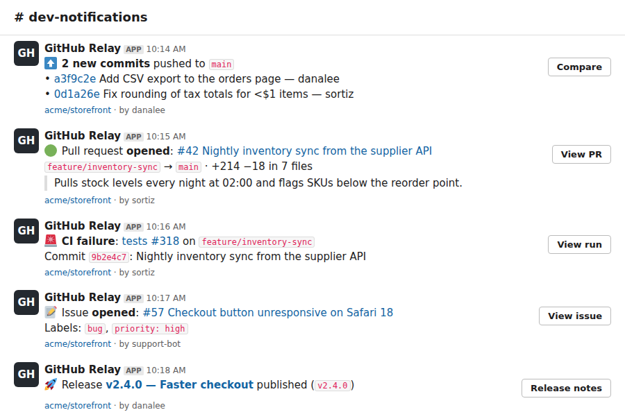

# webhook-slack-relay

[](https://github.com/breezy-development/webhook-slack-relay/actions/workflows/tests.yml) 

A small, reliable service that turns **GitHub webhooks into clean Slack notifications**. It
verifies every request's signature, drops duplicate deliveries, posts readable Block Kit
messages, retries when Slack is rate-limiting or down, and keeps a delivery log so nothing is
silently lost.



<sub>Preview rendered from the relay's actual Block Kit output for the bundled sample events
(not a screenshot of the Slack app). Emoji graphics: [Twemoji](https://github.com/jdecked/twemoji), CC-BY 4.0.</sub>

It's a template for the integration work I do for clients: *receive an event from app A,
check it's genuine, transform it, deliver it to app B, and handle failures properly*. The same
skeleton works for Stripe → Slack, Typeform → Google Sheets, Shopify → email, and so on.

## What it does

| Event | Notification |
|---|---|
| `push` | Commits with short SHAs, first line of each message, author; "Compare" button |
| `pull_request` | Opened / reopened / ready for review / merged / closed, with branches, diff stats and summary |
| `issues` | Opened / closed / reopened, with labels |
| `release` | Published releases and pre-releases |
| `workflow_run` | **Failed or timed-out CI runs only**, so the channel isn't flooded |

Noise like label changes, branch deletions and successful CI runs is acknowledged and skipped.

### Reliability details

- **Signature verification:** HMAC-SHA256 of the raw body (`X-Hub-Signature-256`), compared in
  constant time. Unsigned or tampered requests get `401` and are never logged as deliveries.
- **Idempotent:** GitHub redelivers on timeouts; each `X-GitHub-Delivery` id is processed once.
- **Fast acknowledgement:** responds `202` immediately and posts to Slack in the background,
  well inside GitHub's 10-second timeout.
- **Retries:** network errors and 5xx back off exponentially (1s, 2s, 4s…); `429` honours
  Slack's `Retry-After`. Permanent errors (revoked webhook, `404`) fail fast.
- **Delivery log (SQLite):** every delivery is `delivered`, `skipped`, `dry_run` or `failed`
  with its attempt count and last error. `slack-relay retry-failed` re-sends failures.
- **Safe Slack text:** user content is escaped, so a commit message containing `<!channel>`
  can't ping everyone.
- **Dry-run mode:** without `SLACK_WEBHOOK_URL` it logs what it *would* send, so you can try
  it with no Slack workspace at all.

## Demo


This runs locally against `scripts/mock_slack.py`, a stand-in for Slack that returns
`429 rate_limited` on the first request to show the retry path.

## Quick start

```bash
git clone https://github.com/breezy-development/webhook-slack-relay.git
cd webhook-slack-relay
python -m venv .venv && source .venv/bin/activate
pip install -e .

cp .env.example .env        # then edit it
set -a; source .env; set +a
slack-relay serve --port 8080
```

In another terminal, fire a signed sample event at it:

```bash
set -a; source .env; set +a
slack-relay send-sample pull_request
slack-relay deliveries
```

### Connect it for real

1. **Slack:** create an app at <https://api.slack.com/apps>, enable *Incoming Webhooks*, add one
   to your channel, and put the URL in `SLACK_WEBHOOK_URL`.
2. **Deploy** anywhere that runs a container or Python (a small VPS, Fly.io, Render, Railway…):
   ```bash
   docker build -t webhook-slack-relay .
   docker run -d --env-file .env -v relay-data:/data -p 8080:8080 webhook-slack-relay
   ```
   Put it behind HTTPS (Caddy, nginx, or your platform's TLS).
3. **GitHub:** repo → *Settings* → *Webhooks* → *Add webhook*. Payload URL
   `https://your-host/webhooks/github`, content type `application/json`, the same secret as
   `GITHUB_WEBHOOK_SECRET`, and pick the events you want (or "Send me everything"; disabled
   events are ignored).

## Configuration

| Variable | Required | Default | Meaning |
|---|---|---|---|
| `GITHUB_WEBHOOK_SECRET` | yes | | Shared secret configured on the GitHub webhook |
| `SLACK_WEBHOOK_URL` | no | dry run | Slack incoming-webhook URL |
| `RELAY_EVENTS` | no | `push,pull_request,issues,release,workflow_run` | Events to forward |
| `RELAY_DB_PATH` | no | `relay.db` | SQLite delivery log |
| `RELAY_MAX_ATTEMPTS` | no | `4` | Slack attempts per delivery |

Secrets are read from the environment only and never logged.

## API

| Method & path | Response |
|---|---|
| `POST /webhooks/github` | `202 queued`, `200 duplicate`, `200 skipped/ignored/pong`, `401` bad signature, `400` malformed, `413` too large |
| `GET /healthz` | `{"ok": true, "dry_run": false, "events": [...]}` |

## Development

```bash
pip install -e '.[dev]'
pytest            # 31 tests: signatures, formatters, retry logic, HTTP endpoints
```

```
src/slack_relay/
  app.py         FastAPI app: verify → dedupe → format → deliver in background
  signature.py   HMAC-SHA256 sign/verify
  formatters.py  GitHub payload → Slack Block Kit, one function per event
  slack.py       Slack client with retry / backoff / Retry-After
  store.py       SQLite delivery log
  cli.py         slack-relay serve | send-sample | deliveries | retry-failed
  samples/       realistic sample payloads (used by tests and send-sample)
scripts/mock_slack.py   local Slack stand-in for demos
```

Adding a new event is one formatter function plus a sample payload and a test.

## About

Built by Michael (Breezy Development) with AI-assisted development; every line is reviewed and
tested by a human before it ships.

## License

[MIT](LICENSE)
